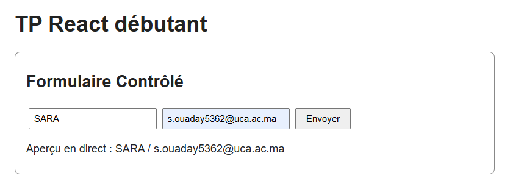
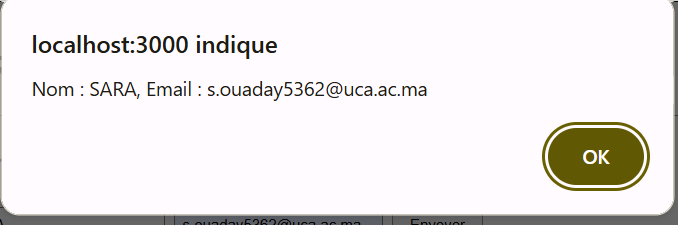
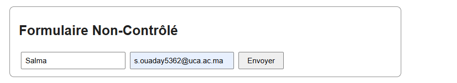
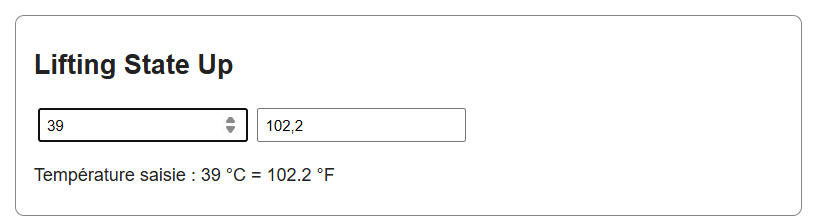
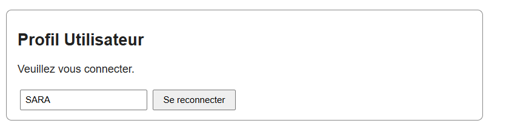
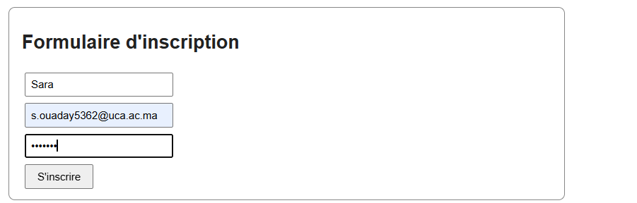
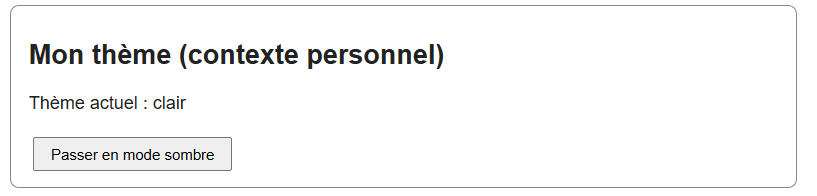
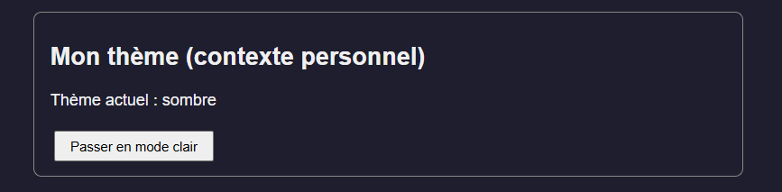

# TP 5 : Gestion de l'état et structuration des composants React

> **Réalisé par :** OUADAY Sara

## Objectifs

- Créer des formulaires contrôlés et non-contrôlés.
- Partager un état entre un parent et un enfant (lifting state up).
- Utiliser le contexte React pour partager des données globales.

## Structure

```
src/
├── App.js
├── App.css
├── FormulaireControle.js
├── FormulaireNonControle.js
├── FormulaireInscription.js
├── TemperatureInput.js
├── TemperatureConvertor.js
├── UtilisateurContext.js
├── Profil.js
├── ThemeContext.js
├── BoutonTheme.js
├── index.js
└── index.css
```

## Formulaire contrôlé

Les champs sont reliés au state avec `value` et `onChange`.





## Formulaire non-contrôlé

La valeur est lue directement avec `useRef`.



## Lifting state up

`TemperatureConvertor` contient l'état et `TemperatureInput` le modifie grâce aux props.



## Contexte utilisateur

`UtilisateurContext.Provider` partage l'utilisateur, et `useContext` le lit dans `Profil`.




### Formulaire d'inscription

Nom, email et mot de passe, avec messages d'erreur.



## Ma partie personnelle

Un deuxième contexte, `ThemeContext`, permet de basculer entre un thème clair et un thème sombre dans toute l'application.





## Conclusion

- Un formulaire contrôlé garde ses valeurs dans le state, un formulaire non-contrôlé les lit avec `useRef`.
- Le parent détient l'état et les enfants le modifient avec des fonctions reçues en props.
- Le contexte évite de passer les mêmes props à travers plusieurs niveaux de composants.
